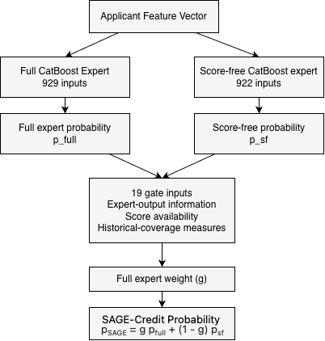
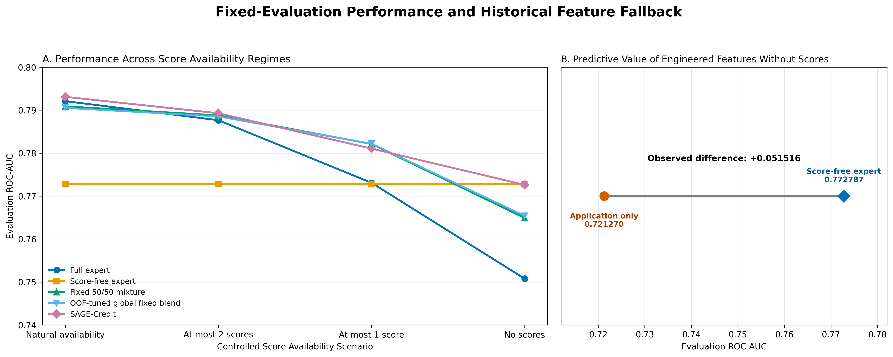

# SAGE-Credit

**Adaptive Expert Gating for Credit Default Prediction Under Variable External-Score Availability**

SAGE-Credit is an availability-aware credit-default prediction system built on the [Home Credit Default Risk](https://www.kaggle.com/competitions/home-credit-default-risk) dataset. It combines two CatBoost experts—a full expert that can use external-score features and a score-free expert that cannot—with a neural gate that assigns an applicant-specific mixture weight.

The central question is practical: can a model retain useful predictive performance when highly informative external-score variables are partially or completely unavailable?



## Headline findings

On the held-out test set, SAGE-Credit achieved the strongest mean performance across four equally weighted external-score availability conditions.

| Score availability | SAGE-Credit ROC-AUC | Full expert ROC-AUC | Score-free expert ROC-AUC |
|---|---:|---:|---:|
| Natural availability | 0.793104 | 0.792093 | 0.772787 |
| At most 2 scores | 0.789273 | 0.787653 | 0.772787 |
| At most 1 score | 0.781043 | 0.773087 | 0.772787 |
| No scores | 0.772607 | 0.750769 | 0.772787 |
| **Mean across conditions** | **0.784007** | **0.775900** | **0.772787** |

Paired applicant-bootstrap comparisons supported an improvement over the validation-selected individual expert in both partial-score conditions. Under natural availability and complete score removal, the confidence intervals included zero. The learned gate progressively shifted weight from the full expert toward the score-free expert as score availability declined.



## Repository contents

```text
SAGE-Credit/
├── notebooks/
│   ├── 01_longitudinal_data_pipeline.ipynb
│   ├── 02_lstm_model_screening.ipynb
│   ├── 03_tabular_pipeline_and_model_screening.ipynb
│   └── 04_sage_credit_experiment.ipynb
├── paper/
│   ├── SAGE-Credit.pdf
│   └── SAGE-Credit.docx
├── figures/
│   └── figure1 ... figure10
├── data/
│   └── README.md
├── requirements.txt
└── CITATION.cff
```

The publication copies of the notebooks preserve the analysis code while replacing machine-specific paths with portable configuration. Cached outputs and execution counts were cleared. The original source notebooks and paper were not modified.

## Reproducing the analysis

### 1. Create an environment

Python 3.10 or 3.11 is recommended.

```bash
python -m venv .venv
source .venv/bin/activate
python -m pip install --upgrade pip
python -m pip install -r requirements.txt
```

The requirements list captures the libraries used by the notebooks; it is not a frozen record of the original training environment.

### 2. Download the data

Download the competition data from [Kaggle](https://www.kaggle.com/competitions/home-credit-default-risk/data) and place the required CSV files in `data/raw/`, or keep them elsewhere and set `HOME_CREDIT_DATA_DIR`.

```bash
export HOME_CREDIT_DATA_DIR=/absolute/path/to/home-credit-default-risk
```

The raw competition data are not redistributed in this repository. See [data/README.md](data/README.md) for the expected files.

### 3. Choose an artifact directory

Intermediate feature tables, predictions, trained models, and evaluation outputs can be very large and are intentionally excluded from Git.

```bash
export SAGE_CREDIT_ARTIFACT_DIR=/absolute/path/to/sage-credit-artifacts
```

If the variable is omitted, notebooks use `artifacts/` at the repository root.

### 4. Run the notebooks

Launch Jupyter from the repository root and execute the notebooks in numeric order:

```bash
jupyter lab
```

The first two notebooks build and evaluate the longitudinal LSTM baseline. The third builds the applicant-level tabular representation and screens the tabular models, incorporating the saved LSTM predictions into its comparison figures. The fourth runs the final SAGE-Credit experiment.

Full execution requires the original Kaggle data, substantial RAM and storage, and long CPU/GPU training time. The final experiment uses CatBoost experts, three-fold out-of-fold prediction, neural-gate training, and 5,000 paired bootstrap resamples.

## Paper and figures

The complete manuscript is available as [PDF](paper/SAGE-Credit.pdf) and [Word document](paper/SAGE-Credit.docx). All ten manuscript figures are included in [`figures/`](figures/), including the data pipelines, model architecture, evaluation results, bootstrap comparison, feature importance, and gate behavior.

## Scope and responsible use

This repository is a research artifact, not a production lending system. The study uses one public anonymized dataset and controlled feature-removal conditions. It does not establish external validity, production readiness, subgroup fairness, suitable lending thresholds, or compliance with any legal or regulatory regime. Do not use the models for real lending decisions without independent validation, fairness analysis, calibration, governance, and domain-specific review.

## Citation

Citation metadata are provided in [`CITATION.cff`](CITATION.cff). GitHub can use that file to generate a formatted software citation.

## License

No open-source license is currently granted. The paper, code, and figures remain under the author's copyright unless a license is added later.
